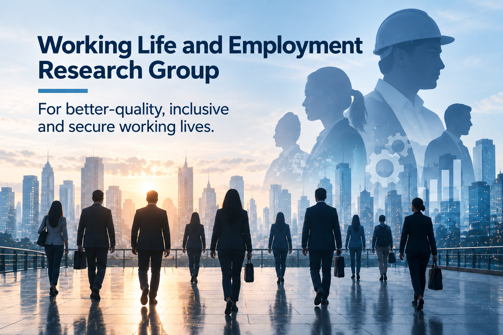

{fig-alt="Working Life and Employment Research Group" fig-align="center" width="560" .research-group-banner}

### About

The Working Life and Employment Research Group examines changes in working life, employment structures and the economic and social effects of labour markets from an interdisciplinary perspective. Its main aim is to produce scientific knowledge that helps us understand the changing world of work and develop more inclusive, secure, fair and sustainable working lives.

Research addresses different dimensions of working life, from employment and unemployment dynamics to working conditions, new forms of work and labour market inequalities. The effects of technological transformation, demographic change, globalisation and economic restructuring are among the group’s central research interests.

### Priority Research Areas

- Labour markets and employment policies
- Unemployment and labour force participation
- Employment quality and working conditions
- Precarious work and in-work poverty
- Work–life balance and working time
- Women’s and youth employment
- Labour market participation of disadvantaged groups
- New forms of work and flexible working
- Remote and hybrid working
- The platform and gig economies
- The effects of digitalisation, automation and artificial intelligence on employment
- Skills at work and the jobs of the future
- Workplace equality, discrimination and inclusion
- Employment relations and social dialogue
- Occupational health, safety and employee wellbeing
- Regional and social inequalities in labour markets

### Research Approach

The group examines working life through **job quality, income security, employee wellbeing, social protection, equality and quality of life**, alongside employment and unemployment indicators.

It uses quantitative and qualitative methods to analyse labour market changes and compare countries, sectors, occupations and social groups.

It focuses particularly on how **digital transformation, artificial intelligence and new forms of work** are reshaping future jobs, occupations and the skills workers need.

### Our Work

The research group supports the production and sharing of knowledge through **research projects • labour market analyses • academic publications • field studies • policy analyses • workshops • conferences • research networks**.

By developing partnerships with academia, public bodies, the private sector, the business community and civil society organisations, it aims to translate research findings into policy and practice.

### Core Objective

**To understand the changing world of work through scientific research and contribute to better-quality, inclusive, secure and sustainable employment and working conditions for everyone.**
