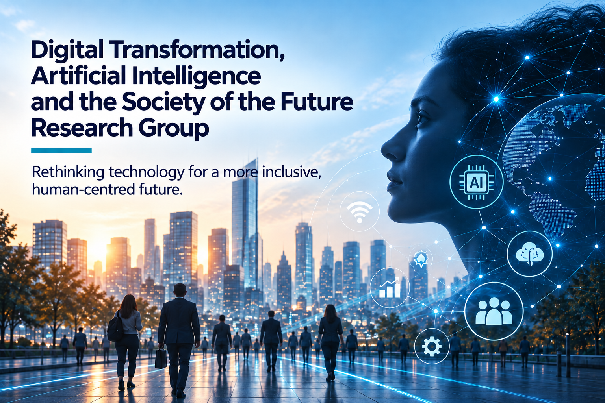

{fig-alt="Digital Transformation, Artificial Intelligence and the Society of the Future Research Group" fig-align="center" width="560" .research-group-banner}

### About

The Digital Transformation, Artificial Intelligence and the Society of the Future Research Group examines the effects of digital technologies, artificial intelligence and automation on working life, the economy and society from an interdisciplinary perspective.

Its main aim is to investigate the opportunities and social risks arising from technological transformation through scientific methods, understand future ways of working and living, and contribute to a more inclusive, fair and human-centred digital transformation.

Research ranges from artificial intelligence and employment to digital skills, future occupations, digital inequalities, algorithmic decision-making and social transformation.

### Priority Research Areas

- Artificial intelligence and society
- Digital transformation and social change
- Artificial intelligence and employment
- Automation and the jobs of the future
- Digital labour and the platform economy
- New forms of work and remote working
- Future occupations and skills
- Digital skills and lifelong learning
- Technological change and labour markets
- Artificial intelligence and education
- Digital inequality and inclusion
- Algorithmic management and working life
- AI ethics and responsible technology
- Technology, social policy and welfare
- Demographic transformation and the society of the future
- Digital entrepreneurship and social innovation
- Technology and sustainable development

### Research Approach

The group understands digital transformation as **a comprehensive process of social change with economic, social, cultural and institutional consequences**.

It examines the effects of artificial intelligence and automation on productivity, employment, income distribution, working conditions and skills requirements, including the possibility that technological change affects social groups unequally.

It therefore focuses on the balance between technological innovation and **social justice, human dignity, equality, social protection and social inclusion**.

### Our Work

The research group supports the production and sharing of knowledge through **research projects • data and policy analyses • field studies • futures studies • academic publications • workshops • conferences • training • policy reports • researcher and expert networks**.

Through partnerships with academia, public bodies, the private sector, technology companies, educational institutions and civil society organisations, it aims to translate research on the social effects of technological transformation into policy and practice.

### Core Objective

**To investigate the social effects of digital transformation and artificial intelligence through scientific methods and develop knowledge and policy recommendations that help technological progress contribute to a more inclusive, fair, sustainable and human-centred future for everyone.**
