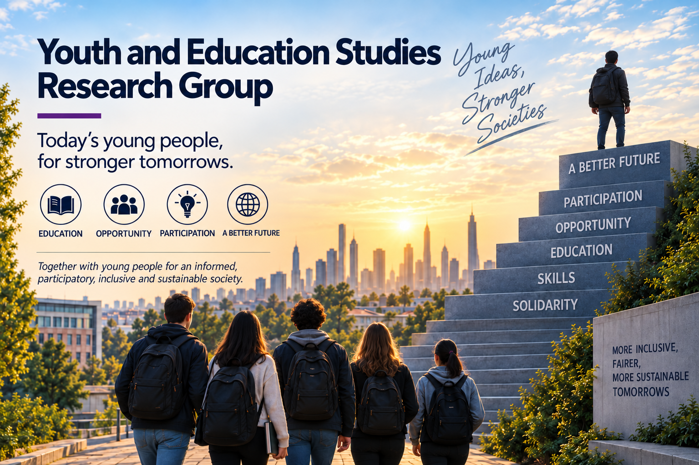
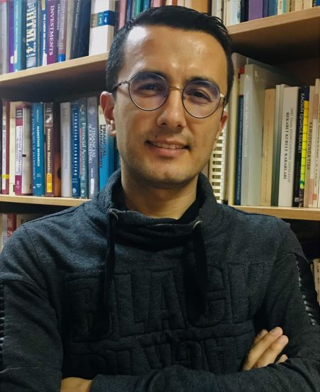
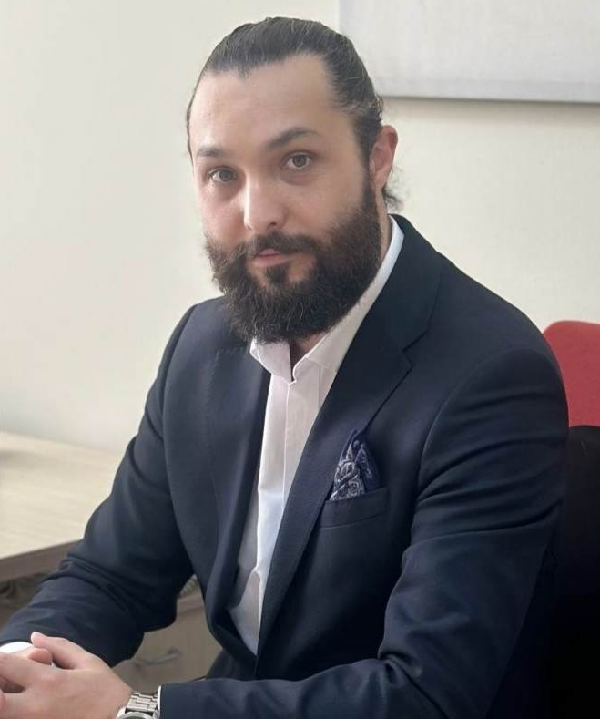

{fig-alt="Youth and Education Studies Research Group" fig-align="center" width="560" .research-group-banner}

::: {.research-team}

## Research Team

### Research Group Co-Leads

<ul class="research-team-leads">
<li><a href="https://avesis.akdeniz.edu.tr/mehmetzanbak" target="_blank" rel="noopener noreferrer">Professor Dr Mehmet ZANBAK</a></li>
<li><a href="https://avesis.hacettepe.edu.tr/sozturk" target="_blank" rel="noopener noreferrer">Associate Professor Dr Muhammet Serhat ÖZTÜRK</a></li>
</ul>

### Team Members

:::

### About

The Youth and Education Studies Research Group examines young people’s participation in education, employment and social life from an interdisciplinary perspective. Its main aim is to understand the opportunities and inequalities they face, examine how education and skills policies affect their lives and produce scientific knowledge that contributes to their social and economic empowerment.

Research focuses on interconnected areas including the transition from education to employment, youth unemployment, skills development, entrepreneurship, digital transformation and young people’s social participation. The effects of changes in education and working life on young people’s futures are central research interests.

### Priority Research Areas

- Youth policies
- Education policies and educational inequality
- The transition from education to work
- Youth employment and unemployment
- Young people not in education, employment or training (NEET)
- Young people’s labour force participation
- Vocational education and skills development
- Future skills and lifelong learning
- Digital skills and digital education
- Youth entrepreneurship and social entrepreneurship
- Young people’s economic and social empowerment
- Youth poverty and social exclusion
- Education, employment and social mobility
- Young people’s social and political participation
- Youth and technology
- Artificial intelligence and the future of education
- Equal opportunities in education and working life
- Young people’s expectations for the future and life choices

### Research Approach

The group understands youth as a significant life stage in which **education, employment, economic independence, social participation and life transitions** take shape, alongside its definition as an age range.

It explores the relationship between education and working life, the match between young people’s skills and labour market needs, and the structural factors affecting their participation in economic and social life.

Using quantitative and qualitative methods, research examines the experiences of different groups of young people and inequalities of opportunity. It focuses particularly on **the effects of digital transformation, artificial intelligence and changes in working life on young people’s educational and career pathways**.

### Our Work

The research group supports the production and sharing of knowledge through **research projects • youth research • education and labour market analyses • field studies • academic publications • policy analyses • workshops • conferences • training • policy reports • early-career researcher networks**.

Through partnerships with academia, public bodies, educational institutions, the private sector, local authorities and civil society organisations, it aims to translate research findings into policies and practices for young people.

### Core Objective

**To produce scientific knowledge that strengthens young people’s participation in education, employment and social life, and contribute to education and youth policies that are more inclusive, equitable and responsive to future needs.**
