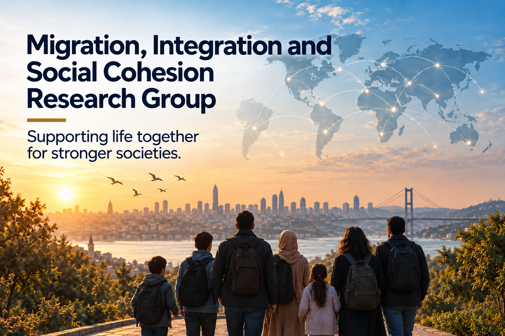
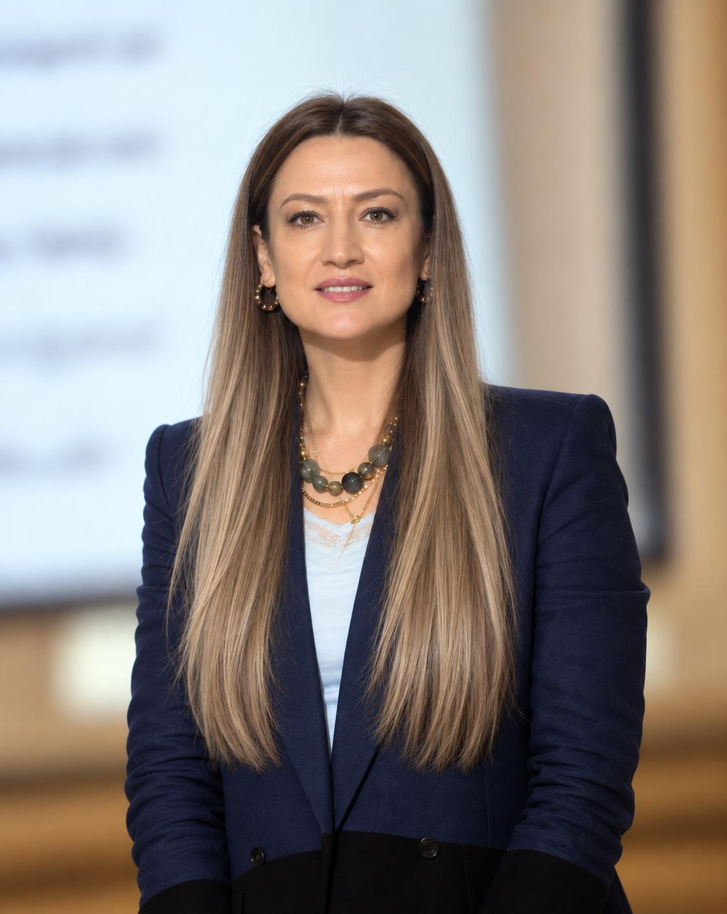

{fig-alt="Migration, Integration and Social Cohesion Research Group" fig-align="center" width="560" .research-group-banner}

::: {.research-team}

## Research Team

### Research Group Co-Leads

<ul class="research-team-leads">
<li><a href="https://avesis.aybu.edu.tr/serikli" target="_blank" rel="noopener noreferrer">Associate Professor Dr Süheyla ERİKLİ SELEK</a></li>
<li><a href="https://web.hitit.edu.tr/meneksesahin" target="_blank" rel="noopener noreferrer">Associate Professor Dr Menekşe ŞAHİN</a></li>
</ul>

### Team Members

:::

### About

The Migration, Integration and Social Cohesion Research Group examines international and internal migration, its economic and social effects and the participation of different migrant groups in society from an interdisciplinary perspective.

Its main aim is to study the causes and consequences of migration through scientific methods, investigate policies and practices that support migrants’ participation in economic and social life, and contribute to an inclusive and cohesive society grounded in solidarity between different groups.

Research covers migration and labour markets, social cohesion, migrant entrepreneurship, education and employment, migration policies and social integration.

### Priority Research Areas

- International and internal migration
- Migration policies and governance
- Migration and labour markets
- Migrant and refugee employment
- Migrant entrepreneurship and social entrepreneurship
- Social cohesion and integration
- Migrants’ economic and social empowerment
- Education, skills and migration
- Young migrants and employment
- Migrant women’s participation in economic and social life
- Migration and poverty
- Migration and social policy
- Social protection and migrants
- Discrimination, exclusion and social inequality
- Intercultural interaction and living together
- Migrants’ participation in local communities
- Migration and urbanisation
- The demographic and economic effects of migration

### Research Approach

The group examines migration through **employment, education, income, social protection, housing, social relationships and quality of life**, alongside border movements and population changes.

Research considers the experiences of migrants and host communities together. It examines the effects of migration on different social groups and understands social cohesion and integration as a reciprocal process.

Quantitative and qualitative methods are used to investigate the factors affecting migrants’ participation in labour markets and social life, with national and international practices assessed comparatively.

### Our Work

The research group supports the production and sharing of knowledge through **research projects • field studies • migration and labour market analyses • social cohesion research • policy analyses • academic publications • workshops • conferences • training • policy reports • researcher and stakeholder networks**.

Through partnerships with academia, public bodies, local authorities, international organisations, the private sector and civil society organisations, it aims to translate findings into social cohesion initiatives and inclusive policy practices.

### Core Objective

**To understand migration through scientific and multidimensional research and develop knowledge and policy recommendations that strengthen migrants’ participation in economic and social life, social cohesion and the ability of different groups to live together.**
