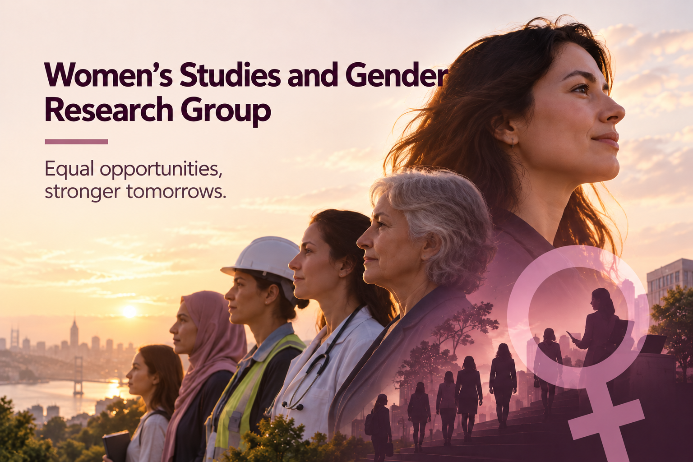
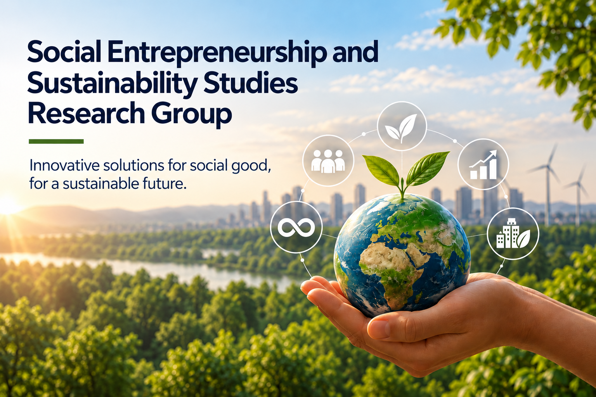

::: {.home-hero}
::: {.home-introduction}

ÇAHSPAR –Working Life and Social Policy Research Association

::: {.home-intro}
The Working Life and Social Policy Research Association (ÇAHSPAR) was established to improve the quality of working and social life through innovative, sustainable, not-for-profit research, training, projects and consultancy in working life and social policy. The association brings together scientific knowledge, vocational education and partnerships between public bodies, universities and civil society to contribute to a fairer and more sustainable world of work.
:::

::: {.hero-actions}
[Learn more about ÇAHSPAR →](about.qmd){.button-primary}
[Become a Member](uye-olun.qmd){.button-secondary}
:::

:::

::: {.home-identity}
{fig-alt="ÇAHSPAR – Working Life and Social Policy Research Association" width="280"}

<a class="social-link social-linkedin" href="https://www.linkedin.com/company/%C3%A7al%C4%B1%C5%9Fma-hayat%C4%B1-ve-sosyal-politika-ara%C5%9Ft%C4%B1rmalar%C4%B1-derne%C4%9Fi/?viewAsMember=true" target="_blank" rel="noopener noreferrer" aria-label="ÇAHSPAR LinkedIn">
<i class="bi bi-linkedin" aria-hidden="true"></i>
</a>
<a class="social-link social-instagram" href="https://www.instagram.com/cahsparder/" target="_blank" rel="noopener noreferrer" aria-label="ÇAHSPAR Instagram">
<i class="bi bi-instagram" aria-hidden="true"></i>
</a>

:::
:::

::: {.home-content-grid}
::: {.home-activities}

## Our Activities

- Publishing research reports, policy briefs and bulletins
- Developing academic research and periodicals
- Organising training, seminars, conferences and workshops
- Delivering national and international projects
- Developing solutions for equality, inclusion and sustainability in working life

:::

::: {.home-announcements}

## Announcements



:::
:::

## Latest Developments

::: {.rss-panel}
::: {.rss-header-row}
::: {.rss-heading-group}
[Selected official data, research and publications]{.rss-kicker}

:::
[Past 30 days]{.rss-live-badge}
:::

:::

## Research Groups

::: {.research-directory}

<a class="research-card" href="sosyal-politika-yoksulluk-ve-refah.html">Social Policy, Poverty and Welfare Research Group↗</a>

<a class="research-card" href="calisma-hayati-ve-istihdam.html">Working Life and Employment Research Group↗</a>

<a class="research-card" href="kadin-calismalari-ve-toplumsal-cinsiyet.html">Women’s Studies and Gender Research Group↗</a>

<a class="research-card" href="sosyal-girisimcilik-ve-surdurulebilirlik.html">Social Entrepreneurship and Sustainability Studies Research Group↗</a>

<a class="research-card" href="dijital-donusum-yapay-zeka-ve-gelecegin-toplumu.html">Digital Transformation, Artificial Intelligence and the Society of the Future Research Group↗</a>

<a class="research-card" href="goc-uyum-ve-sosyal-butunlesme.html">Migration, Integration and Social Cohesion Research Group↗</a>

<a class="research-card" href="genclik-ve-egitim-calismalari.html">Youth and Education Studies Research Group↗</a>

:::
