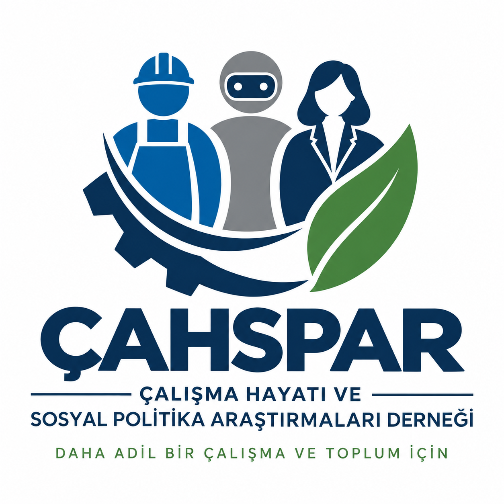

{fig-align="center" width="420"}

## The Meaning of Our Logo

- **The blue figure on the left:** Represents blue-collar workers, labour and production.
- **The grey robot in the centre:** Represents artificial intelligence, automation and the technological transformation of working life.
- **The female figure on the right:** Represents white-collar, knowledge-based and specialist work, and gender equality in working life.
- **The cog below:** Represents production.
- **The green leaf:** Represents sustainable social policies.
- **The three figures within a shared arc:** Represent different groups of workers as part of a shared working and social life.

## A Shared International Purpose

Together, these elements express a research agenda that connects the changing world of work with equality and sustainability across societies. They reflect ÇAHSPAR’s ambition to bring researchers from different countries into dialogue around decent work and inclusive social policy.
