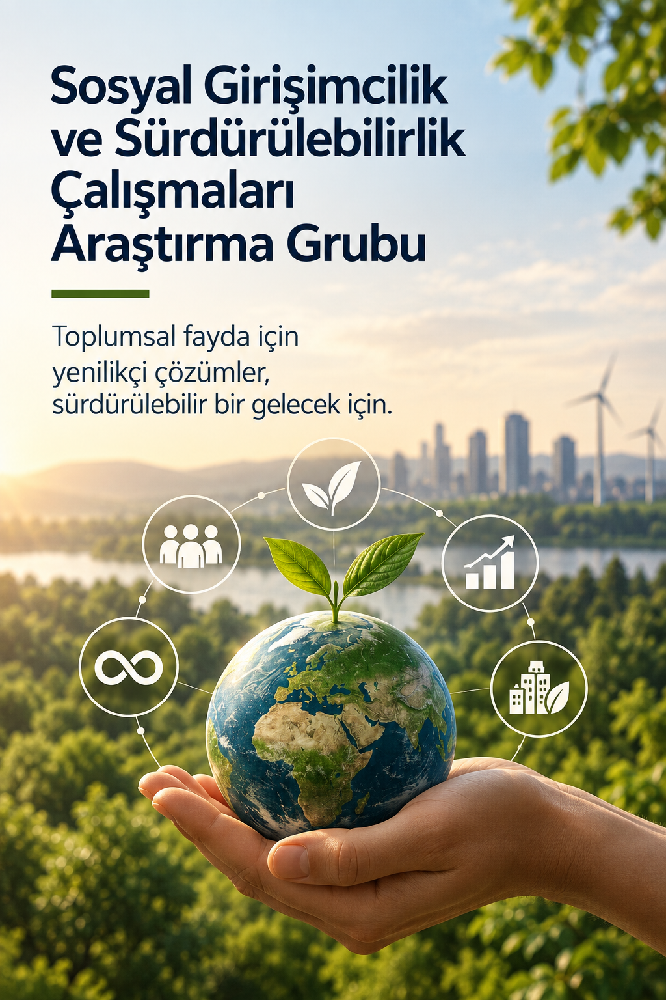

{fig-alt="Social Entrepreneurship and Sustainability Studies Research Group" fig-align="center" width="100%"}

### About

The Social Entrepreneurship and Sustainability Studies Research Group examines social enterprises that develop innovative and sustainable responses to social problems, social innovation and approaches to sustainable development from an interdisciplinary perspective.

Its main aim is to study entrepreneurial models that combine economic, social and environmental value, explore the role of entrepreneurship in addressing social problems and produce scientific knowledge that contributes to sustainable social transformation.

Research covers the emergence, development and social impact of social enterprises, the social and solidarity economy, sustainable business models and social innovation.

### Priority Research Areas

- Social entrepreneurship
- Social innovation
- Sustainable entrepreneurship
- The social and solidarity economy
- Financing social enterprises
- Social impact and impact measurement
- Sustainable business models
- United Nations Sustainable Development Goals
- The circular economy and resource efficiency
- Green entrepreneurship and the green transition
- Governance and stakeholder relations in social enterprises
- Women’s and youth social entrepreneurship
- Digital transformation in social enterprises
- Cooperatives and collective enterprise models
- Local and regional development
- Social entrepreneurship ecosystems
- Partnerships between public bodies, the private sector and civil society
- Innovative solutions to social problems

### Research Approach

The group approaches social entrepreneurship as both an enterprise model and **an alternative way of addressing social problems, creating social value and supporting sustainable development**.

Research brings together social, economic and environmental dimensions. Key topics include measuring the impact of social enterprises, ensuring their sustainability and examining their relationships with stakeholders.

The group also undertakes interdisciplinary research on the links between social entrepreneurship and **social policy, working life, women’s and young people’s economic empowerment, poverty reduction and local development**.

### Our Work

The research group supports the production and sharing of knowledge through **research projects • social impact research • fieldwork • social entrepreneurship analyses • sustainability research • academic publications • policy analyses • training • workshops • conferences • entrepreneur and researcher networks**.

Through partnerships with academia, public bodies, the private sector, social enterprises, cooperatives and civil society organisations, it aims to translate scientific research into practice and social impact.

### Core Objective

**To research entrepreneurial models that develop innovative solutions to social and environmental problems, and contribute to knowledge and practices that support social value creation, sustainable development and inclusive economic growth.**
