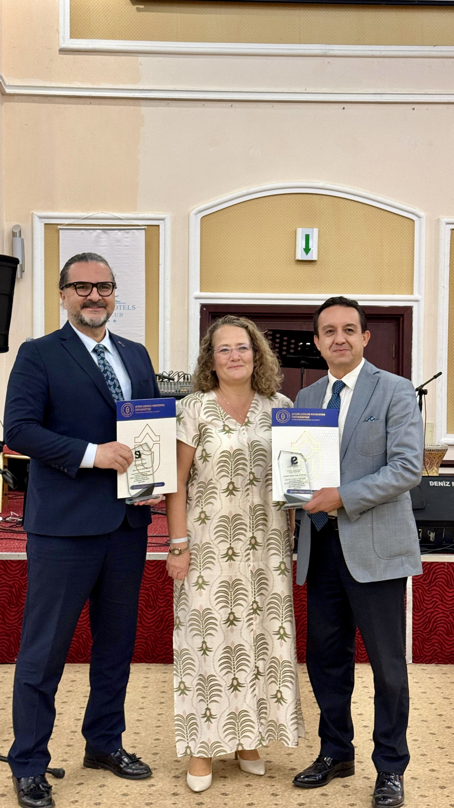

The article “Do Support Mechanisms Ensure a Smooth Labor Market Transition? A Cross-Cultural Qualitative Study on Vocational High School Graduates in Türkiye”, co-authored by our founding board members Professor Dr Volkan Işık and Professor Dr Mustafa Çağlar Özdemir with Research Assistant Dr Bünyamin Yasin Çakmak, has received the Best Article Award in the Article Category of the Social Policy Research Association’s 2026 Social Policy Awards.

The award was presented at the 25th Congress of Labour Economics and Industrial Relations, hosted by Aydın Adnan Menderes University.

The research examines the transition into the labour market of Turkish and Syrian students and graduates of vocational and technical secondary education. It draws on interviews with 154 stakeholders in five provinces. The study explores mismatches between vocational education and labour market expectations, employer attitudes and the effects of employment support. It offers policy recommendations to strengthen school–employer cooperation and align vocational education more closely with industry needs.

{fig-alt="Photograph from the 2026 Social Policy Awards ceremony" fig-align="center" width="650"}

[All announcements →](duyurular.qmd) · [Back to the homepage →](index.qmd#announcements)
