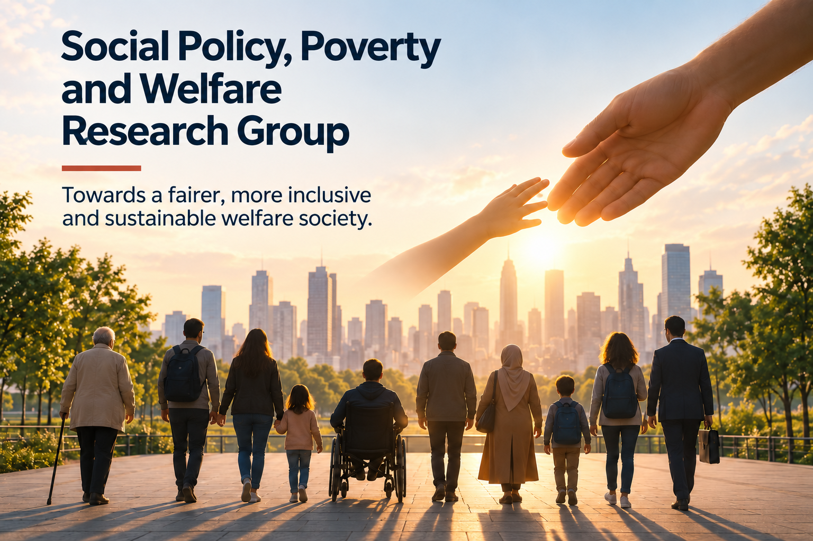

{fig-alt="Social Policy, Poverty and Welfare Research Group" fig-align="center" width="560" .research-group-banner}

### About

The Social Policy, Poverty and Welfare Research Group examines poverty, inequality, social protection and welfare policies from an interdisciplinary perspective. Its main aim is to produce scientific knowledge that improves social welfare and supports more inclusive, fair and sustainable social policies.

Research addresses the causes and consequences of economic and social inequalities, the social risks faced by different groups and the capacity of public policies to respond. Building strong links between academic research and policy implementation is a key priority.

### Priority Research Areas

- Poverty and multidimensional poverty
- Income and wealth inequality
- Social policy and the welfare state
- Social protection and social security
- Social assistance policies
- Child and family welfare
- Women’s poverty and gender inequalities
- Youth and social risks
- Ageing and care policies
- Unemployment and in-work poverty
- Social exclusion and integration
- Policies for disadvantaged groups
- Social services and the care economy
- Social innovation and the social economy

### Research Approach

The group considers poverty and welfare through multiple dimensions, including **employment, education, health, housing, social participation and quality of life**, alongside income.

It uses quantitative and qualitative methods to examine the effectiveness and social impact of social policies, assessing policy alternatives through national and international comparisons.

### Our Work

The research group supports the production and sharing of knowledge through **research projects • academic publications • policy analyses • field studies • workshops • conferences • research networks**.

Through partnerships with academia, public bodies, the private sector and civil society organisations, it aims to translate research findings into policy and practice.

### Core Objective

**To contribute through scientific research to tackling poverty and inequality, strengthening social protection and developing a more inclusive approach to welfare for different sections of society.**
